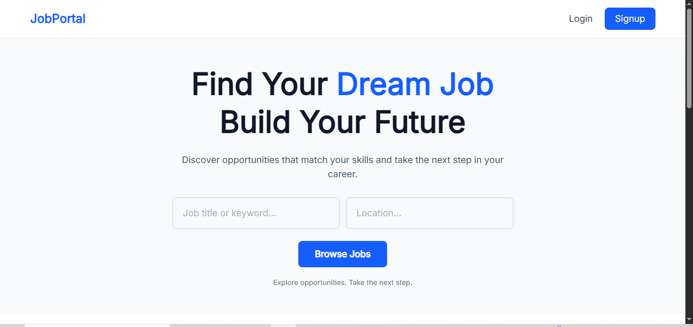
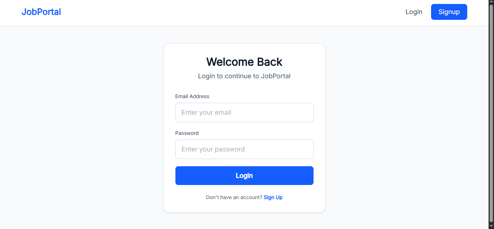
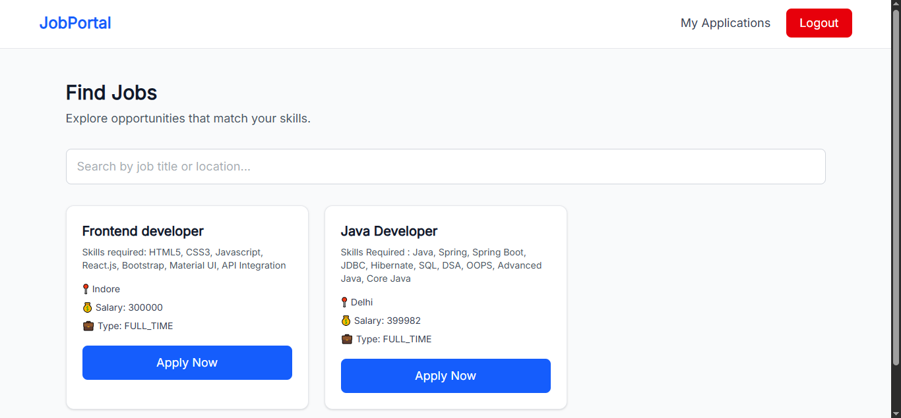
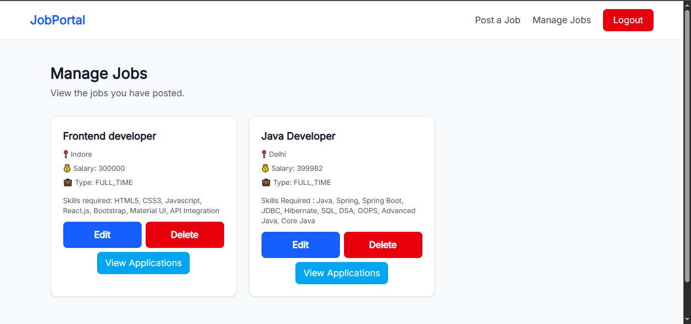
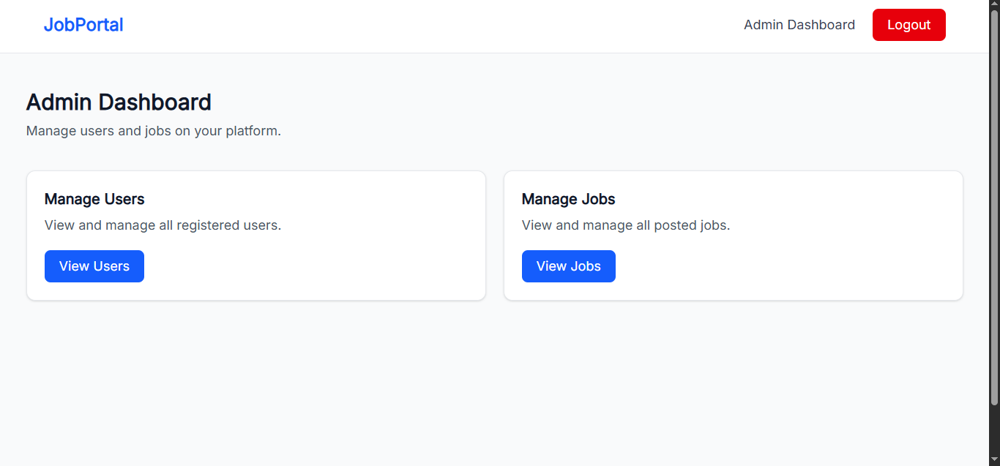
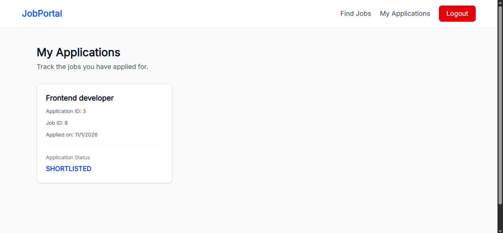

# Online Job Portal

A full-stack web-based Job Portal application built using **Java, Spring Boot, React.js, and MySQL**. The platform connects job seekers with recruiters and provides an admin panel to manage users and job listings.

The application supports role-based access, secure JWT authentication, job management, application tracking, and administrative operations.

## Project Overview

The Online Job Portal is designed to simplify the recruitment process by providing separate functionalities for job seekers, recruiters, and administrators.

- **Job Seekers** can explore job opportunities, search jobs, apply for positions, and track their applications.
- **Recruiters** can publish job openings, manage their job listings, and review applications from candidates.
- **Administrators** can manage users and job listings across the platform.

## Tech Stack

### Frontend
- React.js
- JavaScript (ES6+)
- HTML5
- CSS3
- Tailwind CSS
- Axios
- React Router DOM
- React Hot Toast
- Vite

### Backend
- Java 21
- Spring Boot
- Spring MVC
- Spring Data JPA
- Hibernate
- Spring Security
- JWT Authentication
- Maven
- REST APIs

### Database & Tools
- MySQL
- Git & GitHub
- IntelliJ IDEA
- VS Code
- Postman

## Key Features

### 1. Authentication & Authorization
- User registration and login.
- Secure password hashing using BCrypt.
- JWT-based authentication.
- Stateless authentication using Spring Security.
- Role-based access control.
- Separate access permissions for Job Seekers, Recruiters, and Admins.
- Token management using browser session storage.

- ### Home Page


### Login Page


### 2. Job Seeker Module
- Browse all available job listings.
- Search jobs by title and location.
- View complete job details.
- Apply for jobs.
- View submitted applications.
- Track application status.

- 

### 3. Recruiter Module
- Create new job listings.
- Update existing job details.
- Delete job listings.
- View and manage posted jobs.
- View applications received for individual jobs.
- Update candidate application statuses.

- ### Recruiter Dashboard


### 4. Admin Module
- View all registered users.
- View all job listings.
- Delete users.
- Delete job listings.
- Manage platform data through administrative operations.

- ### Admin Dashboard


### 5. Application Management
The platform supports the following application statuses:

- `APPLIED`
- `SHORTLISTED`
- `HIRED`
- `REJECTED`

Recruiters can update application statuses, allowing candidates to track their recruitment progress.

## Application Architecture

The project follows a layered architecture on the backend and a component-based architecture on the frontend.

### Application Management


### Backend Architecture

The Spring Boot backend follows a layered structure:

- **Controller Layer:** Handles incoming HTTP requests and API responses.
- **Service Layer:** Contains business logic and application workflows.
- **Repository Layer:** Handles database operations using Spring Data JPA.
- **Entity Layer:** Represents database entities.
- **DTO Layer:** Transfers data between frontend and backend without directly exposing entity objects.
- **Security Layer:** Handles JWT authentication and authorization.
- **Exception Layer:** Provides centralized exception handling and consistent error responses.
- **Config Layer:** Contains application and security configurations.

### Frontend Architecture

The React frontend uses reusable components and a service-based API integration structure.

- Component-based UI development.
- React Router for navigation.
- Protected routes for authenticated users.
- Role-based access to application modules.
- Axios for backend API communication.
- Separate services for authentication, jobs, applications, and administration.
- Toast notifications for user feedback.
- Responsive navigation and layouts.

## Project Structure

```text
job-portal/
│
├── job-portal-backend/
│   ├── src/
│   │   ├── main/
│   │   │   ├── java/com/jobportal/job_portal_backend/
│   │   │   │   ├── config/
│   │   │   │   ├── controller/
│   │   │   │   ├── dto/
│   │   │   │   ├── entity/
│   │   │   │   ├── exception/
│   │   │   │   ├── repository/
│   │   │   │   ├── security/
│   │   │   │   ├── service/
│   │   │   │   └── service/impl/
│   │   │   └── resources/
│   │   └── test/
│   ├── pom.xml
│   └── mvnw
│
├── job-portal-frontend/
│   ├── public/
│   ├── src/
│   │   ├── components/
│   │   ├── pages/
│   │   ├── services/
│   │   └── ...
│   ├── package.json
│   └── vite.config.js
│
├── .gitignore
└── README.md
```

## Database Configuration

The application uses MySQL as its relational database.

Create a database:

```sql
CREATE DATABASE job_portal;
```

Configure the following environment variables for the backend:

```properties
DB_URL=jdbc:mysql://localhost:3306/job_portal
DB_USERNAME=your_mysql_username
DB_PASSWORD=your_mysql_password
JWT_SECRET=your_secure_jwt_secret
```

The backend reads database credentials and the JWT secret from environment variables instead of hardcoding sensitive information.

## Installation & Setup

### Prerequisites

Make sure the following tools are installed:

- Java JDK 21
- Maven (optional, as Maven Wrapper is included)
- Node.js and npm
- MySQL Server
- Git

### 1. Clone the Repository

```bash
git clone https://github.com/AyaanSaifi-01/job-portal.git
```

Navigate to the project directory:

```bash
cd job-portal
```

### 2. Backend Setup

Navigate to the backend directory:

```bash
cd job-portal-backend
```

Configure the required environment variables:

- `DB_URL`
- `DB_USERNAME`
- `DB_PASSWORD`
- `JWT_SECRET`

Make sure MySQL is running and the `job_portal` database exists.

Run the backend:

**Windows:**

```bash
mvnw.cmd spring-boot:run
```

**Linux/macOS:**

```bash
./mvnw spring-boot:run
```

### 3. Frontend Setup

Open another terminal and navigate to the frontend directory:

```bash
cd job-portal/job-portal-frontend
```

Install dependencies:

```bash
npm install
```

Start the development server:

```bash
npm run dev
```

Open the local URL displayed by Vite in your browser.

Make sure the frontend API configuration points to the running backend server.

## Security Implementation

Security is an important part of this application.

- Passwords are encrypted using BCrypt hashing.
- JWT tokens are used for authentication.
- Spring Security manages authentication and authorization.
- Role-based permissions restrict access to protected endpoints.
- Stateless session management is configured.
- Sensitive configuration values are managed through environment variables.
- DTOs are used to control the data exposed through API responses.

## Future Enhancements

Potential improvements for future versions include:

- Resume upload and management.
- Email notifications for application updates.
- Advanced job filtering and sorting.
- Pagination for job listings.
- Recruiter and candidate profile management.
- Job recommendations based on candidate skills.
- Cloud deployment and production monitoring.

## Author

**Ayaan Saifi**

GitHub: [AyaanSaifi-01](https://github.com/AyaanSaifi-01)

## Repository

[Online Job Portal – GitHub](https://github.com/AyaanSaifi-01/job-portal)

---

*Built as a full-stack development project to demonstrate practical implementation of Java, Spring Boot, React.js, REST APIs, MySQL, and secure role-based application development.*
